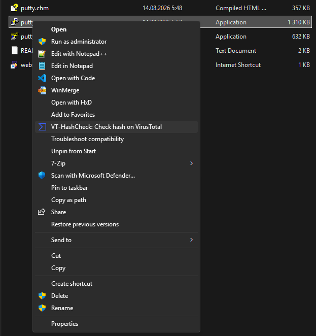
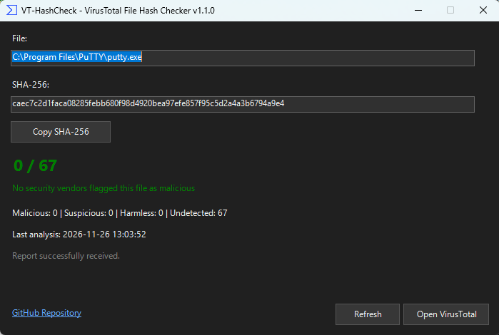

# VT-HashCheck

Windows context menu integration for VirusTotal - https://www.virustotal.com.

A lightweight PowerShell utility that calculates SHA-256 hashes, retrieves existing file analysis reports through the official VirusTotal API v3, and displays scan results in a Windows GUI.

Check files directly from Windows Explorer without manually opening the VirusTotal website or uploading files.

**Disclaimer**: VT-HashCheck is an independent, community-developed project. It is not affiliated with, endorsed by, or officially associated with VirusTotal. VirusTotal and its trademarks belong to their respective owners.

This project only implements requests to the publicly available VirusTotal API. It does not reproduce, redistribute, or claim ownership of any proprietary VirusTotal software, website, or components.

## Screenshots

### Windows Context Menu



### Main Application Window



## Features

- Windows context menu integration – check any file directly from File Explorer.
- Command-line file checking – launch the script manually with a file path, without installing the context menu.
- SHA-256 calculation – automatically calculate the selected file's hash.
- VirusTotal API v3 integration – retrieve existing file analysis reports.
- Detection statistics – display malicious, suspicious, harmless, and undetected results.
- Last analysis date – see when the file was last analyzed.
- Open VirusTotal report – view the file's report in your default browser.
- Copy SHA-256 – copy the calculated hash to the clipboard.
- Windows theme support – automatically adapt to light and dark Windows themes.

**Note**: The utility retrieves existing VirusTotal reports. It does not upload files to VirusTotal.

## Requirements

- VirusTotal account and API key
- Windows (tested on Windows 11)
- Windows PowerShell
- .NET Framework
- Internet connection

A free VirusTotal account can be used to obtain an API key. API usage is subject to VirusTotal's account limits and terms.

Get your API key:

https://www.virustotal.com/gui/my-apikey

## Installation

### 1. Download the repository

Clone the repository or download it as a ZIP archive and extract it to any convenient folder.

For example:

```text
C:\Apps\VT-HashCheck\
```

Expected directory structure:

```text
VT-HashCheck/
├── VT-HashCheck.ps1
├── VirusTotal.ico
├── LICENSE
└── README.md
```

The `virustotal-api.key` file will be created manually in the next step.

### 2. Configure the API key

Create a text file named:

```text
virustotal-api.key
```

Paste your VirusTotal API key into this file and save it in the same directory as `VT-HashCheck.ps1`.

Important: Never share your API key or commit `virustotal-api.key` to a public repository.

### 3. Install the context menu entry

Open PowerShell and run the installer from the extracted repository directory:

```powershell
powershell.exe -NoProfile -ExecutionPolicy Bypass -File ".\VT-HashCheck.ps1" -Install
```

The installer automatically detects its own directory and registers the correct paths to `VT-HashCheck.ps1` and `VirusTotal.ico`.

The application can be installed in any directory. No administrator privileges are required because the context menu integration is registered under the current user's registry.

If you move the application to another directory, run the installer again to update the registry paths.

## Usage

### Windows Context Menu

After installation:

1. Open Windows File Explorer.
2. Right-click any file.
3. Select **Show more options** if necessary.
4. Click **VT-HashCheck: Check hash on VirusTotal**.
5. Wait for the SHA-256 calculation and VirusTotal report.

### Command-Line Usage (without context menu)

You can also check files by launching the PowerShell script directly. Installing the Windows context menu is not required.

Open PowerShell or Windows Terminal and execute:

```powershell
powershell.exe -NoProfile -ExecutionPolicy Bypass -File ".\VT-HashCheck.ps1" -FilePath "C:\Path\To\File.exe"
```

Replace the example path with the actual path to the file you want to check.

For example:

```powershell
powershell.exe -NoProfile -ExecutionPolicy Bypass -File ".\VT-HashCheck.ps1" -FilePath "C:\Program Files\PuTTY\putty.exe"
```

File paths containing spaces must be enclosed in quotation marks.

The application will open its GUI, calculate the file's SHA-256 hash, and retrieve the existing VirusTotal analysis report.

**Note**: Command-line mode and context menu mode use the same functionality and API key configuration. The API key must be stored in `virustotal-api.key` in the application directory.

## Security and Privacy

- Files are not uploaded by this utility.
- Only the file's SHA-256 hash is sent to VirusTotal for report lookup.
- The API key is stored locally in `virustotal-api.key`.
- The API key should never be included in public commits.
- API requests are made using the official VirusTotal API v3 in accordance with its usage restrictions and limits.

## Uninstallation

To remove the context menu entry, execute the following command in PowerShell from the application directory:

```powershell
powershell.exe -NoProfile -ExecutionPolicy Bypass -File ".\VT-HashCheck.ps1" -Uninstall
```

This removes the context menu integration from Windows File Explorer.

Afterwards, you can safely delete the application directory, including:

- `VT-HashCheck.ps1`
- `VirusTotal.ico`
- `virustotal-api.key`

No additional cleanup is required.

## License

Licensed under the GNU General Public License v3.0 (GPL-3.0).